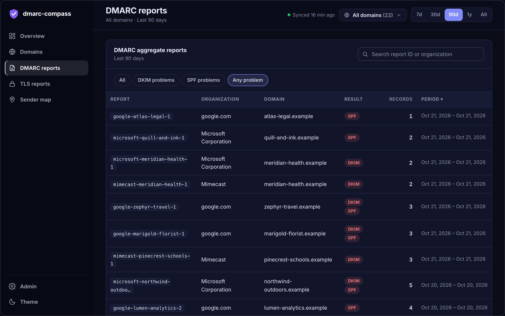
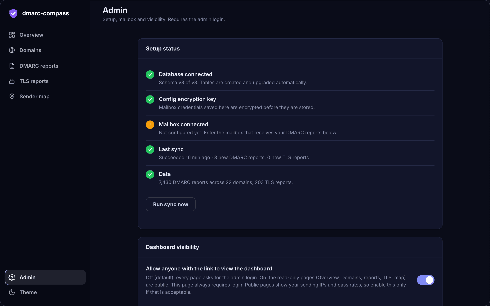
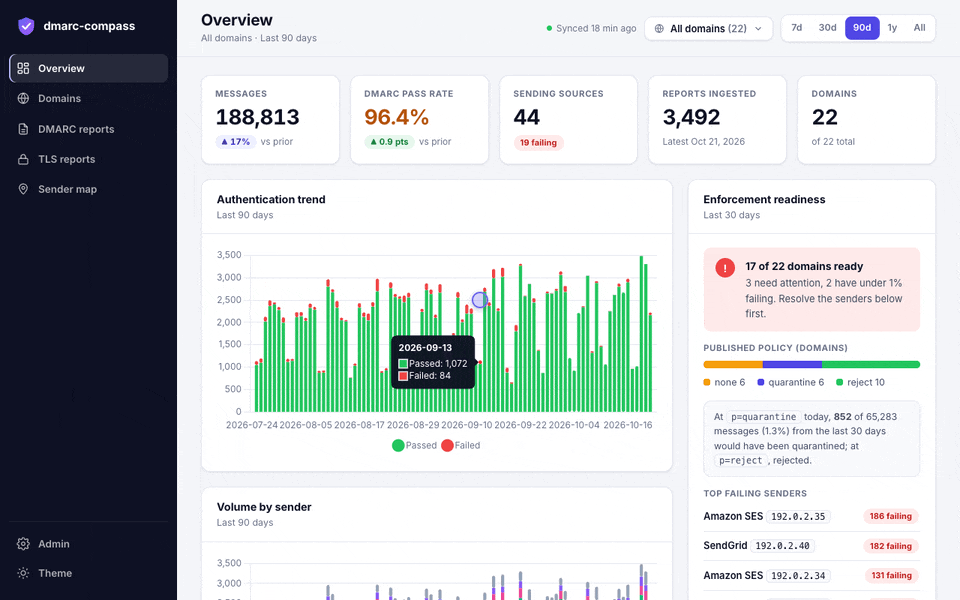

<div align="center">


# dmarc-compass

**DMARC and TLS-RPT reporting that runs in your own Cloudflare account.**

Point your domains' `rua=` address at one mailbox and see who is sending as you,<br>what is failing, and whether you are ready to move from `p=none` to `p=reject`.

[Quick start](#quick-start) &nbsp;·&nbsp; [Features](#features) &nbsp;·&nbsp; [Try the demo](#try-it-without-a-mailbox) &nbsp;·&nbsp; [How it works](#how-it-works) &nbsp;·&nbsp; [Security](#security-model)

<br>


<sub>Every screenshot and recording here uses synthetic data: invented <code>.example</code> domains and documentation-range IP addresses.</sub>

</div>

<br>

## Features

<table>
  <tr>
    <td width="33%" valign="top"><b>Built for many domains</b><br><sub>A searchable domain multi-select and a time range on every page, kept in the URL. Designed for fleets of hundreds or thousands of domains.</sub></td>
    <td width="33%" valign="top"><b>Enforcement readiness</b><br><sub>Which sources fail alignment in the last 30 days, and how many messages a tighter policy would have quarantined or rejected.</sub></td>
    <td width="33%" valign="top"><b>Sender identification</b><br><sub>Raw IPs become "Amazon SES" or "Google Workspace", with trends over time and every source plotted on a map.</sub></td>
  </tr>
  <tr>
    <td valign="top"><b>TLS-RPT included</b><br><sub>MTA-STS and DANE reports sit next to your DMARC data.</sub></td>
    <td valign="top"><b>No server to run</b><br><sub>Workers, D1 and one container. <code>git clone</code>, <code>npm install</code>, <code>npm run setup</code>.</sub></td>
    <td valign="top"><b>Configured in the browser</b><br><sub>Mailbox credentials, visibility and manual syncs live on a login-protected <code>/admin</code> page. Credentials are encrypted at rest.</sub></td>
  </tr>
</table>

<div align="center">
  <br>
  
</div>

<br>

> **Status:** early. It does what is described here and nothing more; see [Limitations](#limitations).

## Screenshots

<table>
  <tr>
    <td width="50%"><a href="docs/images/domains.png"></a><br><sub><b>Domains.</b> Riskiest first, with policy, status, failing volume and pass rate.</sub></td>
    <td width="50%"><a href="docs/images/map.png"></a><br><sub><b>Sender map.</b> Sized by volume, coloured by pass rate.</sub></td>
  </tr>
  <tr>
    <td><a href="docs/images/reports.png"></a><br><sub><b>DMARC reports.</b> Search, sort, and isolate DKIM or SPF problems.</sub></td>
    <td><a href="docs/images/tls.png"></a><br><sub><b>TLS reports.</b> Session success per domain and the latest failures.</sub></td>
  </tr>
  <tr>
    <td><a href="docs/images/overview-light.png"></a><br><sub><b>Light theme.</b> Dark is the default; switch from the sidebar.</sub></td>
    <td><a href="docs/images/admin.png"></a><br><sub><b>Admin.</b> Setup checklist, visibility switch and mailbox settings.</sub></td>
  </tr>
</table>

### Filters that follow you everywhere

<div align="center">
  
</div>

## Quick start

**You need:** a Cloudflare account on the **Workers Paid** plan, **Docker** running locally, **Node.js 20+**, and a mailbox with **IMAP** that receives your `rua=` reports.

```bash
git clone https://github.com/<you>/dmarc-compass.git
cd dmarc-compass
npm install
npm run setup
```

`npm run setup` logs you into Cloudflare if needed, deploys the Worker (Wrangler creates the D1 database for you), sets the admin login, and generates the encryption key. Press Enter at the password prompt and a strong one is generated and shown once. `--dry-run` shows what it would do without changing anything.

Then open `https://<your-worker>.workers.dev/admin`, sign in, enter your mailbox, and click **Run sync now**. The first sync takes about a minute while the container starts; after that it runs every 15 minutes.

Nothing in the repository is specific to your account. Wrangler records your resource IDs in `wrangler.local.jsonc`, which is gitignored.

<details>
<summary><b>Cost</b></summary>

<br>

Containers are not available on the free plan. Budget roughly **$6 to $7 per month**: the $5 plan fee plus about $1.75 of container memory and disk beyond the included allowance. The container runs continuously because the 15-minute sync keeps it awake. See [current Containers pricing](https://developers.cloudflare.com/containers/platform/pricing/).

</details>

<details>
<summary><b>Point your domains at the mailbox</b></summary>

<br>

Each domain publishes a DMARC record. Start in monitoring mode:

```
_dmarc.example.com.  TXT  "v=DMARC1; p=none; rua=mailto:dmarc@reports.example.net"
```

If the reporting mailbox is on a **different domain** than the domain being reported on, the receiving side requires a one-time authorization record on the mailbox's domain, for each reported domain ([RFC 7489 §7.1](https://datatracker.ietf.org/doc/html/rfc7489#section-7.1)):

```
example.com._report._dmarc.reports.example.net.  TXT  "v=DMARC1"
```

A wildcard record (`*._report._dmarc.reports.example.net`) covers every domain at once if you manage many.

</details>

<details>
<summary><b>Mailbox notes (Gmail, Fastmail, Zoho, Microsoft 365)</b></summary>

<br>

Use an app-specific password wherever your provider offers one. To check a mailbox independently of this project, run `python3 scripts/test-imap.py`: it logs in, lists the exact folder names, and counts messages.

- **Gmail / Google Workspace:** `imap.gmail.com`, port 993. Needs 2-step verification and an app password.
- **Fastmail:** `imap.fastmail.com`, port 993, with an app password.
- **Zoho Mail:** `imap.zoho.com` for personal accounts, `imappro.zoho.com` for custom-domain accounts. IMAP must be enabled **both** in the user's mail settings **and** in the Zoho admin console. Log in with the account's **primary** address, not an alias.
- **Microsoft 365 / Outlook.com:** password-based IMAP is no longer offered, so this does not connect directly. The [upstream project documents a DavMail proxy](https://github.com/cry-inc/dmarc-report-viewer/tree/master/ms-365) as a workaround.

Folder names are case-sensitive. Reports are often filtered into a subfolder; enter its name in the Folder field.

</details>

## Using it

A sidebar holds the navigation and the theme toggle. The top bar carries two **global filters** that apply to every page: a searchable **domain multi-select** and a **time range** (7d, 30d, 90d, 1y, All). The default range is **90 days**. Large tables are searchable, sortable and paginated.

| Page | What it is for |
|---|---|
| **Overview** | Totals, pass/fail trend, volume by sender, sending sources and enforcement readiness, compared with the previous period. |
| **Domains** | One row per domain, riskiest first: policy, status (enforced, ready to tighten, needs attention), volume, pass rate, last report. |
| **DMARC reports** | Every report, filterable by DKIM or SPF problems, with per-record detail. |
| **TLS reports** | SMTP TLS (MTA-STS and DANE) results and failures. |
| **Sender map** | Where your mail is being sent from. |
| **Admin** | Setup status, mailbox settings, dashboard visibility, manual sync. Always requires login. |

**Who can see the dashboard.** By default every page requires the admin login. In **Admin** you can switch on *Allow anyone with the link to view the dashboard*, which makes the read-only pages public. Those pages show your sending IPs, senders and pass rates, so decide whether that is acceptable first. `/admin` is never public.

## Try it without a mailbox

Explore the whole UI locally with synthetic data, with no Cloudflare account or IMAP mailbox. It is 22 invented `.example` domains with realistic sender mixes, a few misconfigured senders, and some TLS failures, and it is how the screenshots above were made.

```bash
npm install
cp .dev.vars.example .dev.vars
npm run dev          # leave running; open http://localhost:8787 once so the tables are created
npm run demo         # in a second terminal: loads the demo data into the local database
```

Reload the page. `npm run demo` only ever writes to the local simulator (it always passes `--local`), never to a deployed database, and it replaces any reports already in the local database. Docker must be running, as for any `wrangler dev` with a container.

## How it works

<details>
<summary><b>Architecture</b></summary>

<br>

```
 receivers (Google, Microsoft, ...)         your domains' rua= address
            │  daily XML reports                      │
            └────────────────► one IMAP mailbox ◄─────┘
                                      │
                    ┌─────────────────▼──────────────────┐
                    │  Container: dmarc-report-viewer     │   parses mail + reports
                    │  (upstream project, unmodified)     │   (in memory, JSON API)
                    └─────────────────▲──────────────────┘
                                      │ every 15 min
                    ┌─────────────────┴──────────────────┐
                    │  Worker (this repo)                 │
                    │   • sync job  → writes to D1        │
                    │   • dashboard → reads from D1       │
                    │   • /admin    → settings, status    │
                    └─────────────────┬──────────────────┘
                                      ▼
                          D1 (the durable copy of your data)
```

The container is the parser and holds everything in memory; it forgets it on restart. The Worker copies each new report into **D1**, which is what the dashboard reads, so your history survives container restarts. D1 tables are created and upgraded automatically on the first request after each deploy. There is no migration step.

A report is identified by reporter + report ID + domain, enforced by a unique index. The container's own per-report hash changes whenever its mailbox settings change, so it is deliberately not used to decide whether a report has been seen.

</details>

## Operating it

```bash
npm run deploy      # ship changes; also upgrades the database schema on first request
npm run dev         # local development (copy .dev.vars.example to .dev.vars first)
npm run tail        # live logs
npm run typecheck
```

**Updating:** `git pull && npm install && npm run deploy`.

**The dashboard is empty:** open **Admin** and read *Setup status*; it names what is missing. If the mailbox looks right but nothing arrives, run `scripts/test-imap.py` to separate a mailbox problem from a deployment problem.

**Uninstalling:** `npx wrangler delete -c wrangler.local.jsonc`, then delete the D1 database and the container application from the Cloudflare dashboard.

## Security model

- The admin login is a Worker secret (`ADMIN_USER` / `ADMIN_PASSWORD`) compared on every request to `/admin`. It is HTTP Basic Auth, so always use the HTTPS `workers.dev` or custom-domain URL.
- Mailbox credentials entered on `/admin` are encrypted with AES-GCM using `CONFIG_ENCRYPTION_KEY`, a write-only Worker secret, before they reach D1. They are never sent back to the browser. **Do not rotate or lose that key without re-entering the mailbox password**: the stored value can no longer be decrypted.
- State-changing requests from `/admin` require a custom request header that a cross-site form cannot send (CSRF protection).
- The container is only reachable through the Worker; nothing on the public URL is proxied to it.
- The public-dashboard switch defaults to **off**.

Found a vulnerability? Please report it privately through GitHub's *Security → Report a vulnerability* rather than a public issue.

## Limitations

- **One container instance.** Fine for hundreds of domains' worth of reports; not horizontally scaled.
- **No forensic (RUF) reports.** The upstream parser does not support them, and large receivers have mostly stopped sending them.
- **Geolocation uses [ip-api.com](https://ip-api.com)**, whose free tier is **non-commercial only** and rate-limited, so new addresses are resolved gradually. For commercial use, get a plan from them or swap the lookup.
- **Sync de-duplication** compares the container's report list against every report already in D1. That is fine for tens of thousands of reports and worth revisiting well beyond that.
- **No alerting or scheduled reports yet** (the daily cron trigger is reserved for it).

## Roadmap

Alerting (new sender, pass-rate drop) to Slack, email or webhook · enforcement rollout tracking over time (`pct=25 → 100 → reject`) · BIMI readiness check · JSON API and CSV export.

## Contributing

Issues and pull requests are welcome. Run `npm run typecheck` before submitting. Schema changes are made by **appending** a migration in `src/migrations.ts`; never edit one that has shipped.

## License

[MIT](LICENSE). Built on [dmarc-report-viewer](https://github.com/cry-inc/dmarc-report-viewer) by cry-inc (MIT), run unmodified. See [NOTICE.md](NOTICE.md) for third-party software and service terms.
