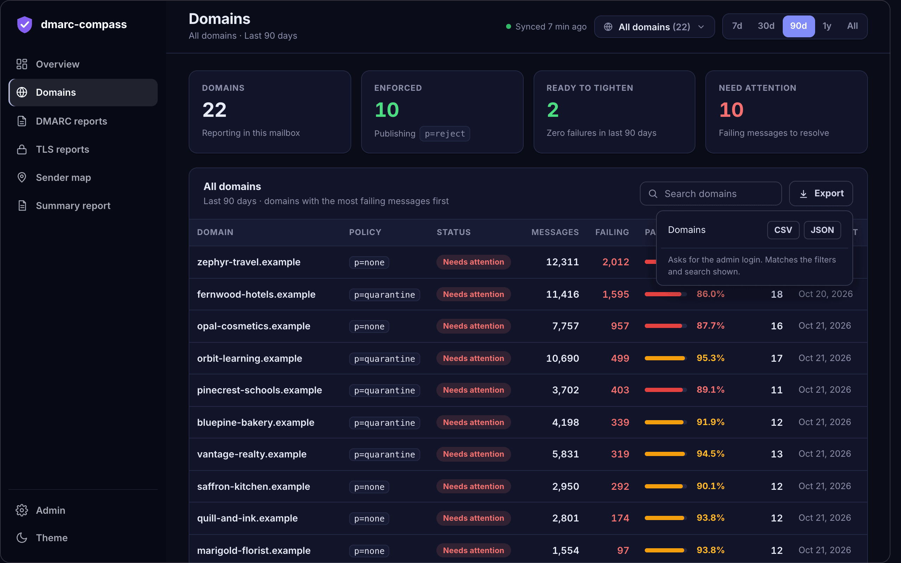

<div align="center">


# dmarc-compass

**DMARC and TLS-RPT reporting that runs in your own Cloudflare account.**

Point your domains' `rua=` addresses at one or more mailboxes and see who is sending as you,<br>what is failing, and whether you are ready to move from `p=none` to `p=reject`.

[Quick start](#quick-start) &nbsp;·&nbsp; [Features](#features) &nbsp;·&nbsp; [Try the demo](#try-it-without-a-mailbox) &nbsp;·&nbsp; [How it works](#how-it-works) &nbsp;·&nbsp; [Security](#security-model)

<br>


<sub>Every screenshot and recording here uses synthetic data: invented <code>.example</code> domains and documentation-range IP addresses.</sub>

</div>

<br>

## Features

<table>
  <tr>
    <td width="33%" valign="top"><b>Built for many domains</b><br><sub>A searchable domain multi-select and a time range on every page, kept in the URL. Designed for fleets of hundreds or thousands of domains.</sub></td>
    <td width="33%" valign="top"><b>Enforcement readiness</b><br><sub>Which sources fail alignment in the last 30 days, and how many messages a tighter policy would have quarantined or rejected.</sub></td>
    <td width="33%" valign="top"><b>Sender identification</b><br><sub>Raw IPs become "Amazon SES" or "Google Workspace", with trends over time, every source plotted on a map, and TLS-RPT reports alongside.</sub></td>
  </tr>
  <tr>
    <td valign="top"><b>Alerts and webhooks</b><br><sub>Alerts for new failing senders, pass-rate drops, policy changes and sync problems, plus a scheduled digest, to Slack or any URL as signed JSON.</sub></td>
    <td valign="top"><b>Exports and reports</b><br><sub>CSV or JSON from every table, matching your filters, and a printable one-document summary report you can save as PDF.</sub></td>
    <td valign="top"><b>No server to run</b><br><sub>Workers, D1 and one container, configured from a login-protected <code>/admin</code> page. <code>git clone</code>, <code>npm install</code>, <code>npm run setup</code>.</sub></td>
  </tr>
</table>

<div align="center">
  <br>
  
</div>

<br>

> **Status:** early. It does what is described here and nothing more; see [Limitations](#limitations).

## Screenshots

<table>
  <tr>
    <td width="50%"><a href="docs/images/domains.png"></a><br><sub><b>Domains.</b> Riskiest first, with policy, status, failing volume and pass rate.</sub></td>
    <td width="50%"><a href="docs/images/map.png"></a><br><sub><b>Sender map.</b> Sized by volume, coloured by pass rate.</sub></td>
  </tr>
  <tr>
    <td><a href="docs/images/reports.png"></a><br><sub><b>DMARC reports.</b> Search, sort, and isolate DKIM or SPF problems.</sub></td>
    <td><a href="docs/images/tls.png"></a><br><sub><b>TLS reports.</b> Session success per domain and the latest failures.</sub></td>
  </tr>
  <tr>
    <td><a href="docs/images/overview-light.png"></a><br><sub><b>Light theme.</b> Dark is the default; switch from the sidebar.</sub></td>
    <td><a href="docs/images/admin-webhooks.png"></a><br><sub><b>Webhooks.</b> Slack or signed JSON, with per-webhook routing, test and remove.</sub></td>
  </tr>
  <tr>
    <td><a href="docs/images/summary-report.png"></a><br><sub><b>Summary report.</b> A one-document summary to print to PDF or download as HTML.</sub></td>
    <td><a href="docs/images/export-menu.png"></a><br><sub><b>Export.</b> CSV or JSON from every table, matching your filters.</sub></td>
  </tr>
</table>

### Filters that follow you everywhere

<div align="center">
  
</div>

## Quick start

**You need:** a Cloudflare account on the **Workers Paid** plan, **Docker** running locally, **Node.js 20+**, and a mailbox with **IMAP** that receives your `rua=` reports.

```bash
git clone https://github.com/<you>/dmarc-compass.git
cd dmarc-compass
npm install
npm run setup
```

`npm run setup` logs you into Cloudflare if needed, deploys the Worker (Wrangler creates the D1 database for you), sets the admin login, and generates the encryption key. Press Enter at the password prompt and a strong one is generated and shown once. `--dry-run` shows what it would do without changing anything.

Then open `https://<your-worker>.workers.dev/admin`, sign in, enter your mailbox, and click **Run sync now**. The first sync takes about a minute while the container starts; after that it syncs every 15 minutes, or on whatever schedule you choose under **Admin → Setup status → Sync schedule**.

Nothing in the repository is specific to your account. Wrangler records your resource IDs in `wrangler.local.jsonc`, which is gitignored.

<details>
<summary><b>Cost</b></summary>

<br>

Containers are not available on the free plan. Budget roughly **$6 to $7 per month**: the $5 plan fee plus about $1.75 of container memory and disk beyond the included allowance. With the default 15-minute sync the container stays awake continuously. A longer interval can let it sleep between syncs, but I have not measured what that saves. See [current Containers pricing](https://developers.cloudflare.com/containers/platform/pricing/).

</details>

<details>
<summary><b>Point your domains at the mailbox</b></summary>

<br>

Each domain publishes a DMARC record. Start in monitoring mode:

```
_dmarc.example.com.  TXT  "v=DMARC1; p=none; rua=mailto:dmarc@reports.example.net"
```

If the reporting mailbox is on a **different domain** than the domain being reported on, the receiving side requires a one-time authorization record on the mailbox's domain, for each reported domain ([RFC 7489 §7.1](https://datatracker.ietf.org/doc/html/rfc7489#section-7.1)):

```
example.com._report._dmarc.reports.example.net.  TXT  "v=DMARC1"
```

A wildcard record (`*._report._dmarc.reports.example.net`) covers every domain at once if you manage many.

</details>

<details>
<summary><b>Mailbox notes (Gmail, Fastmail, Zoho, Microsoft 365)</b></summary>

<br>

Use an app-specific password wherever your provider offers one. To check a mailbox independently of this project, run `python3 scripts/test-imap.py`: it logs in, lists the exact folder names, and counts messages.

- **Gmail / Google Workspace:** `imap.gmail.com`, port 993. Needs 2-step verification and an app password.
- **Fastmail:** `imap.fastmail.com`, port 993, with an app password.
- **Zoho Mail:** `imap.zoho.com` for personal accounts, `imappro.zoho.com` for custom-domain accounts. IMAP must be enabled **both** in the user's mail settings **and** in the Zoho admin console. Log in with the account's **primary** address, not an alias.
- **Microsoft 365 / Outlook.com:** password-based IMAP is no longer offered, so this does not connect directly. The [upstream project documents a DavMail proxy](https://github.com/cry-inc/dmarc-report-viewer/tree/master/ms-365) as a workaround.

Folder names are case-sensitive. Reports are often filtered into a subfolder; enter its name in the Folder field.

</details>

## Using it

A sidebar holds the navigation and the theme toggle. The top bar carries two **global filters** that apply to every page: a searchable **domain multi-select** and a **time range** (7d, 30d, 90d, 1y, All). The default range is **90 days**. Large tables are searchable, sortable and paginated.

| Page | What it is for |
|---|---|
| **Overview** | Totals, pass/fail trend, volume by sender, sending sources and enforcement readiness, compared with the previous period. |
| **Domains** | One row per domain, riskiest first: policy, status (enforced, ready to tighten, needs attention), volume, pass rate, last report. |
| **DMARC reports** | Every report, filterable by DKIM or SPF problems, with per-record detail and the original XML and JSON (view or download). |
| **TLS reports** | SMTP TLS (MTA-STS and DANE) results and failures. |
| **Sender map** | Where your mail is being sent from. |
| **Summary report** | A printable one-document summary for the current filters: key findings, trend, domain status, failing senders, policy changes, TLS. Print it to PDF or download it as HTML. |
| **Admin** | Four tabs down the left side: **Setup status**, **Mailboxes**, **Dashboard visibility** and **Notifications** (webhooks, a collapsible **Alert rules** section, and the digest). Each tab has its own link, such as `/admin#notifications`. Always requires login. |

**Who can see the dashboard.** By default every page requires the admin login. In **Admin** you can switch on *Allow anyone with the link to view the dashboard*, which makes the read-only pages public. Those pages show your sending IPs, senders and pass rates, so decide whether that is acceptable first. `/admin` is never public.

### Sync schedule

**Admin → Setup status → Sync schedule** sets how often the mailboxes are checked: every 5, 10, 15 or 30 minutes, or every 1, 2, 4, 6, 12 or 24 hours. The default is 15 minutes. Receiving providers send aggregate reports about once a day, so a short interval mostly finds nothing new; it mainly matters if you want alerts quickly.

The Worker wakes every 5 minutes (the cron in `wrangler.jsonc`) and runs a sync only when one is due, so the interval changes without a redeploy. Every wake-up also checks alerts and the digest, so they are on time whatever the interval. The **Run sync now** button is always available, and counts as a sync for the schedule.

Things that follow from it:
- The parser container re-reads the mailbox every 5 to 15 minutes while awake (matching your interval, capped at 15). Changing the interval can restart the container once, on the next sync.
- Each sync waits for the parser to finish reading before copying reports, so a container that slept between syncs and woke up empty is handled. If a mailbox never finishes (wrong login or folder), the sync reports a timeout and the *Sync problem* alert fires, instead of quietly syncing nothing.
- If you deployed an earlier version, its cron fired every 15 minutes. Intervals shorter than that need `"crons": ["*/5 * * * *"]` in your wrangler config and a redeploy; Admin shows a warning if the deployed schedule is slower than the interval you chose.

## Scale

I tested with generated data, on a local SQLite database standing in for D1 (`npm run bench -- typical|stress`, see `scripts/bench`). Milliseconds on D1 will differ; the query plans, query counts and memory are what carry over.

| | Typical | Stress |
|---|---|---|
| Domains | 1,500 | 1,500 |
| History | 90 days | 2 years |
| Reports / records | 126 thousand / 418 thousand | 1.06 million / 3.5 million |
| Database size | 97 MB | 835 MB |

What I measured at the stress size, after the fixes in this version:

| | Time |
|---|---|
| Overview, last 7 / 30 / 90 days | 0.2 s / 0.6 s / 1.6 s |
| Reports list (any range) | under 0.03 s |
| Domains, last 90 days / all time | 0.2 s / 0.6 s |
| Map, last 90 days | 0.5 s |
| Exports (capped at 100,000 rows) | under 0.6 s |
| Alerts check, digest | about 0.3 s each |
| Overview, **last year** / **all time** | 7.7 s / 9 s |
| Summary report, last 90 days / **all time** | 2 s / 10 s |

- **Long ranges are the slow part.** Every figure on the Overview comes from adding up the records in the range, so a year or all time of a 1,500-domain fleet reads millions of rows. I did not build summary tables for this: with many mail providers reporting the same sending addresses the saving is small (about 1.25 times fewer rows in my data), so it is not worth the extra code. If you keep years of history and look at long ranges often, tell me and I will revisit it.
- **Sync** no longer loads the whole report list. It reads it as a stream, checks the last 30 days of reports every sync, and walks older history in steps, remembering where it got to. At 1 million reports it used about 10 MB (the Worker allows 128 MB) and 40 to 80 database calls per sync, against 700 MB and 12,000 calls before. The walk is repeated once a month to catch reports that arrive very late.
- **A big first import is spread over several syncs.** Each sync copies up to 600 new reports, newest first, and syncs again at the next 5-minute wake-up until the backlog is gone. Years of mail for a large fleet therefore fill in over some hours, with the most recent weeks first. The Worker's limits (1,000 database calls and 128 MB per run) are why it is not done at once.
- **The parser container is the likely limit on history.** It keeps every report in memory and sends the whole list on each sync, so its memory grows with the mailbox, not with the database. I have not measured this. The database keeps history after mail is deleted, so for very large fleets, archive old report emails out of the mailbox and keep the dashboard history in D1.
- **D1 limits**: 10 GB per database, 30 seconds per query. The stress size is under a tenth of the database limit.

## Several mailboxes

If your reports arrive in more than one mailbox (different `rua=` addresses, a separate TLS-RPT address, one per business unit), add them all under **Admin → Mailboxes**. Each has a nickname, host, user, password and folder, and a **Test** button that logs in and opens the folder (it reports a wrong password, a disabled IMAP setting or a missing folder in plain words). **Pause** skips a mailbox without removing it.

Everything is combined: the dashboard, exports, summary report and alerts show one view, sorted by domain, and a report that reaches two mailboxes is stored once. Each report remembers which mailbox it came from.

**How it works, and what it costs.** One parser container reads the mailboxes **in turns**, so the cost stays what it is with a single mailbox. On each sync run it loads a mailbox, waits for the parser to finish reading it, copies the new reports into the database, then moves to the next. If a run is short of time it stops and the next run continues from the mailbox it did not reach, so none is starved. A mailbox that fails (wrong password, server down) is recorded on its row and never stops the others.

- **More mailboxes means each is refreshed less often**, because the parser has to re-read a folder after every switch. A small mailbox takes about a minute; a very large folder can take several (raise `READ_TIMEOUT_SECONDS`, default 240, if a large one times out). With one mailbox nothing is switched or re-read.
- **Original XML/JSON** for a report from a mailbox the parser is not holding takes up to a minute to fetch, because it has to switch first. The buttons show progress while it works. The parsed data in the dashboard is always available.
- Up to 10 mailboxes. If you need them refreshed more often than this allows, the alternative is one container per mailbox, which costs roughly $1.75 per month more for each.

## Exports and reports

**Export.** Every table has an **Export** menu with CSV and JSON downloads that match what is on screen: the same domain filter, time range and search.

| Dataset | One row per |
|---|---|
| Domains | domain: policy, status, messages, failing, pass rate, last report |
| Sending sources | source IP: sender, reverse DNS, messages, failing, issues |
| DMARC reports | report: reporter, period, policy, messages, failing |
| Every record | source per report: the raw authentication results |
| TLS results / TLS failures | TLS policy result / failure detail |

CSV files open correctly in Excel and Sheets (UTF-8 with a byte order mark). Text that a spreadsheet could interpret as a formula, such as a sender name starting with `=` or `@`, is prefixed with an apostrophe so it stays text; report data comes from third parties, so this matters. Each export is capped at 100,000 rows; if a file hits the cap the `X-Export-Truncated` header (and a `truncated` field in JSON) says so, and a shorter time range or domain filter gets the rest.

**Summary report.** Open **Summary report** in the sidebar for a clean, light, one-document summary of the current filters. Use **Print / Save as PDF** in your browser, or **Download HTML** for a self-contained file you can email or archive (no scripts, no external requests).

Exports and the summary report **always require the admin login**, even when the dashboard is public, because a bulk export of every source IP is more than page-by-page browsing is meant to hand out. The original report XML and JSON follow the same rule.

## Notifications

Alerts and a periodic digest go to one or more **webhooks**: Slack-compatible incoming webhooks (Slack, Mattermost, and others that accept the same format), or **JSON webhooks** that POST a structured document to any URL (your own service, n8n, Zapier, a SIEM). Nothing is sent until you add one.

1. In Slack, create an *Incoming Webhook* for the channel you want and copy its URL.
2. Open **Admin → Notifications**, give it an optional **nickname** (for example `#dmarc-alerts`), paste the URL, and press **Add webhook**.
3. Press **Test** on its row to confirm a message arrives.

Choose the **type** when you add a webhook. Each webhook is a row showing its nickname, its type, a masked form of its URL, whether it receives **Alerts** and/or the **Digest** (so security alerts and a management digest can go to different channels), and how its last delivery went. Rename it, change what it receives, **Test** it or **Remove** it right from the row. You can add up to 10. A webhook supplied as a `SLACK_WEBHOOK_URL` Worker secret appears as a read-only row.

**Alert rules.** Checked after every sync. Each event is reported once, and several alerts from one sync arrive as one message.

| Rule | Fires when | Default |
|---|---|---|
| **New failing sender** | A source fails DMARC for a domain it was not seen on before | at least 20 failing messages |
| **Pass rate dropped** | A domain's pass rate over the last 7 days is lower than the 7 days before | 5 points, at least 100 messages in each week |
| **Policy changed** | A domain's published `p=` or `pct=` changed (stricter or relaxed) | on |
| **Sync problem** | Syncing is failing or has stopped; a note is sent when it recovers | 90 minutes without a successful sync, or three times the sync interval if that is longer |

**Digest.** Off by default. Choose every day, every week, every month, or every *N* days, plus the time and time zone. It covers the last complete days of that period: messages and pass rate against the period before, domain status, the most failing domains, policy changes and new failing senders. Digests are sent within 5 minutes of the chosen time; if a run is missed it is sent once on the next run.

**Preview alerts** shows what the rules would have reported over the last 7 days without sending anything, and **Send digest now** sends one immediately.

If every webhook that should receive an alert is unreachable, nothing is lost: an alert is only marked as sent once at least one webhook accepts it, so it is retried on the next run. If one of several is down, the others still deliver, and the failure is shown on that row. A notification problem never fails a sync.

### JSON webhooks

A JSON webhook receives `POST` requests with `Content-Type: application/json`. Every document has `schema` (for example `dmarc-compass.alerts.v1`; the suffix changes only on a breaking change), `event` (`alerts`, `digest` or `test`), `source` and `sent_at` (ISO 8601, UTC), and `links` back to the dashboard once you have opened Admin.

```json
{
  "schema": "dmarc-compass.alerts.v1",
  "event": "alerts",
  "count": 2,
  "alerts": [
    { "rule": "new_failing_sender", "message": "example.com Amazon SES 192.0.2.1 75 failing of 75 messages",
      "domain": "example.com", "source_ip": "192.0.2.1", "sender": "Amazon SES", "failing_messages": 75, "total_messages": 75 },
    { "rule": "pass_rate_drop", "domain": "example.com", "previous_pass_rate_pct": 99.1, "current_pass_rate_pct": 84.3, "drop_points": 14.8 }
  ]
}
```

Alert rules are `new_failing_sender`, `pass_rate_drop`, `policy_change` and `sync_problem`. The digest document has `period`, `totals` (messages, pass rate, previous pass rate, sources), `domains` (counts by status and the most failing), `policy_changes` and `new_failing_senders`.

**Signing.** If you set a signing secret, each request carries `X-Dmarc-Compass-Timestamp` and `X-Dmarc-Compass-Signature: sha256=<hex>`, where the signature is `HMAC-SHA256(secret, "<timestamp>.<raw body>")`. Verify it, and reject old timestamps so a captured request cannot be replayed:

```js
import { createHmac, timingSafeEqual } from "node:crypto";

function verify(rawBody, headers, secret, toleranceSeconds = 300) {
  const ts = headers["x-dmarc-compass-timestamp"];
  if (Math.abs(Date.now() / 1000 - Number(ts)) > toleranceSeconds) return false;
  const expected = "sha256=" + createHmac("sha256", secret).update(`${ts}.${rawBody}`).digest("hex");
  const given = headers["x-dmarc-compass-signature"] ?? "";
  return given.length === expected.length && timingSafeEqual(Buffer.from(given), Buffer.from(expected));
}
```

Respond with any `2xx` status. A non-`2xx` response or a timeout (8 seconds) is treated as a failed delivery.

## Try it without a mailbox

Explore the whole UI locally with synthetic data, with no Cloudflare account or IMAP mailbox. It is 22 invented `.example` domains with realistic sender mixes, a few misconfigured senders, and some TLS failures, and it is how the screenshots above were made.

```bash
npm install
cp .dev.vars.example .dev.vars
npm run dev          # leave running; open http://localhost:8787 once so the tables are created
npm run demo         # in a second terminal: loads the demo data into the local database
```

Reload the page. `npm run demo` only ever writes to the local simulator (it always passes `--local`), never to a deployed database, and it replaces any reports already in the local database. Docker must be running, as for any `wrangler dev` with a container.

## How it works

<details>
<summary><b>Architecture</b></summary>

<br>

```
 receivers (Google, Microsoft, ...)         your domains' rua= address
            │  daily XML reports                      │
            └────────────────► IMAP mailbox(es) ◄─────┘
                                      │
                    ┌─────────────────▼──────────────────┐
                    │  Container: dmarc-report-viewer     │   parses mail + reports
                    │  (upstream project, unmodified)     │   (in memory, JSON API)
                    └─────────────────▲──────────────────┘
                                      │ every sync interval
                    ┌─────────────────┴──────────────────┐
                    │  Worker (this repo)                 │
                    │   • sync job  → writes to D1        │
                    │   • dashboard → reads from D1       │
                    │   • /admin    → settings, status    │
                    └─────────────────┬──────────────────┘
                                      ▼
                          D1 (the durable copy of your data)
```

The container is the parser and holds everything in memory; it forgets it on restart. The Worker copies each new report into **D1**, which is what the dashboard reads, so your history survives container restarts. D1 tables are created and upgraded automatically on the first request after each deploy. There is no migration step.

A report is identified by reporter + report ID + domain, enforced by a unique index. The container's own per-report hash changes whenever its mailbox settings change, so it is deliberately not used to decide whether a report has been seen.

</details>

## Operating it

```bash
npm run deploy      # ship changes; also upgrades the database schema on first request
npm run dev         # local development (copy .dev.vars.example to .dev.vars first)
npm run tail        # live logs
npm run typecheck
npm test            # unit tests (schedule math, mailbox rotation, settings, escaping, security)
npm run vendor      # refresh public/vendor after bumping Chart.js, Leaflet or Inter
```

**Updating:** `git pull && npm install && npm run deploy`.

**The dashboard is empty:** open **Admin** and read *Setup status*; it names what is missing. If the mailbox looks right but nothing arrives, run `scripts/test-imap.py` to separate a mailbox problem from a deployment problem.

**Uninstalling:** `npx wrangler delete -c wrangler.local.jsonc`, then delete the D1 database and the container application from the Cloudflare dashboard.

## Security model

- The admin login is a Worker secret (`ADMIN_USER` / `ADMIN_PASSWORD`) compared on every request to `/admin`. It is HTTP Basic Auth, so always use the HTTPS `workers.dev` or custom-domain URL.
- Mailbox credentials entered on `/admin` are encrypted with AES-GCM using `CONFIG_ENCRYPTION_KEY`, a write-only Worker secret, before they reach D1. They are never sent back to the browser. **Do not rotate or lose that key without re-entering the mailbox password**: the stored value can no longer be decrypted.
- State-changing requests from `/admin` require a custom request header that a cross-site form cannot send (CSRF protection).
- The container is only reachable through the Worker. The one thing the Worker fetches from it on request is the original report XML/JSON, and that always requires the admin login, even when the dashboard is public. Files are served as plain text with a restrictive `Content-Security-Policy`.
- Webhook URLs are credentials: they are stored encrypted (as one list) like the mailbox password, never shown back in the browser, and never written to logs or error messages. Only a masked form is displayed.
- Alert text includes domain and reporter names taken from third-party reports, so everything sent to Slack is escaped. A crafted report cannot inject links or mentions (such as `@channel`).
- Exports, the summary report and the original report files always require the admin login, and CSV cells that could run as spreadsheet formulas are neutralised.
- JSON webhook signing secrets are stored encrypted with the webhook list and are never shown again.
- **Login throttling.** Ten wrong passwords from one address within 15 minutes lock that address out for 15 minutes (HTTP 429, with `Retry-After`). IPv6 clients are grouped by /64. Requests with no credentials, such as a browser's first try, are not counted, and the public dashboard is unaffected.
- **Content-Security-Policy.** Pages run only scripts that carry a per-response random nonce, can contact only their own origin, and cannot be framed. Report data is escaped as well, so this is a second layer: markup injected through a crafted report still could not run. The Chart.js, Leaflet and Inter files are served from the app itself (`public/vendor`), so the dashboard makes no requests to CDNs; the Sender map page alone also loads OpenStreetMap tiles. Other headers set on every response: `X-Frame-Options`, `X-Content-Type-Options`, `Referrer-Policy`, `Permissions-Policy`, `Strict-Transport-Security`, Cross-Origin policies.
- The admin credentials are compared in constant time.
- The public-dashboard switch defaults to **off**.

Found a vulnerability? Please report it privately through GitHub's *Security → Report a vulnerability* rather than a public issue.

## Limitations

- **One container instance.** Fine for hundreds of domains' worth of reports; not horizontally scaled. Several mailboxes share it by taking turns (see above).
- **Original XML/JSON comes from the parser**, which re-reads the report's mailbox. If a report email has been deleted or moved out of the configured folder, the parsed data stays in the dashboard but the original file is no longer available.
- **No forensic (RUF) reports.** The upstream parser does not support them, and large receivers have mostly stopped sending them.
- **Geolocation uses [ip-api.com](https://ip-api.com)**, whose free tier is **non-commercial only** and rate-limited, so new addresses are resolved gradually. For commercial use, get a plan from them or swap the lookup.
- **Sync de-duplication** compares the container's report list against every report already in D1. That is fine for tens of thousands of reports and worth revisiting well beyond that.
- **Exports are capped at 100,000 rows** each (narrow the time range or domains for more).
- **Alerts cover DMARC and sync health, not TLS failures yet**, and are delivered only to Slack-compatible webhooks (no direct email).

## Roadmap

Email delivery and TLS failure alerts · enforcement rollout tracking over time (`pct=25 → 100 → reject`) · BIMI readiness check · JSON API and CSV export.

## Contributing

Issues and pull requests are welcome. Run `npm run typecheck` and `npm test` before submitting. Schema changes are made by **appending** a migration in `src/migrations.ts`; never edit one that has shipped.

## License

[MIT](LICENSE). Built on [dmarc-report-viewer](https://github.com/cry-inc/dmarc-report-viewer) by cry-inc (MIT), run unmodified. See [NOTICE.md](NOTICE.md) for third-party software and service terms.
