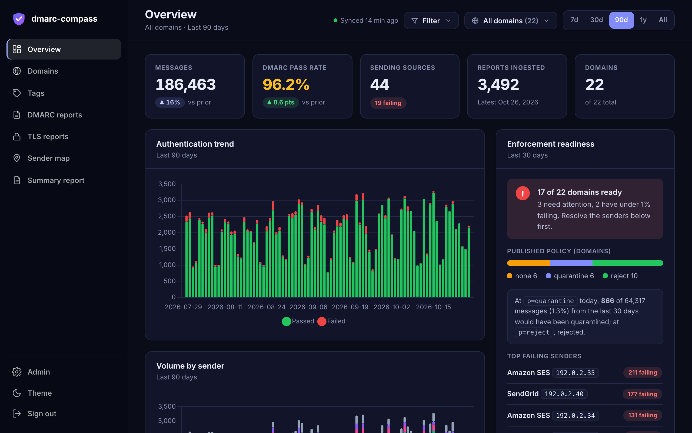
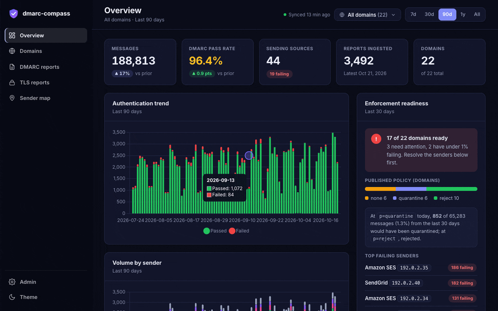
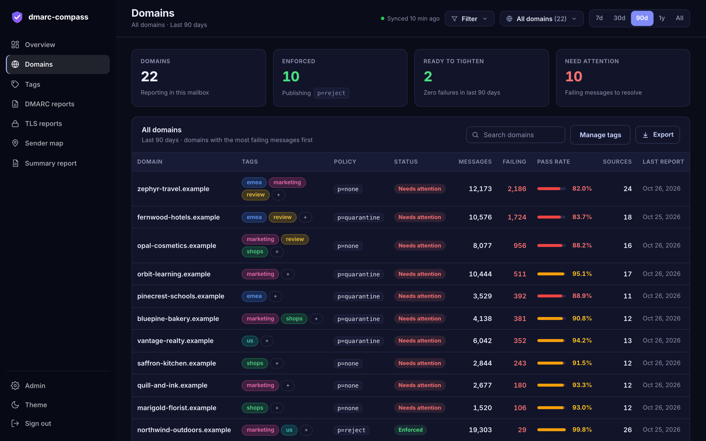
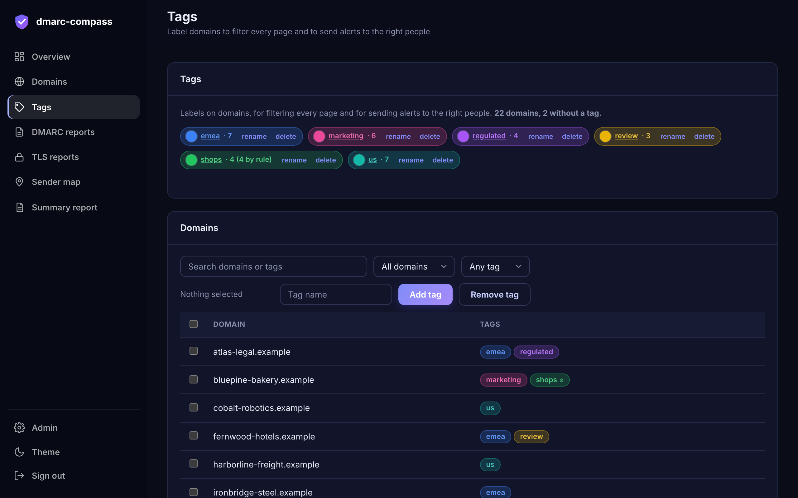
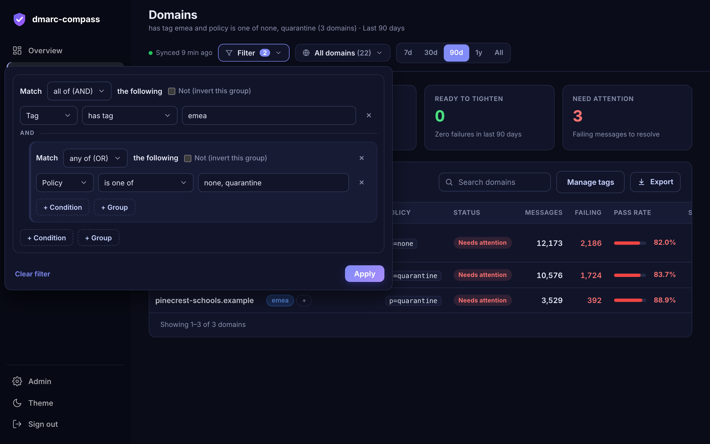
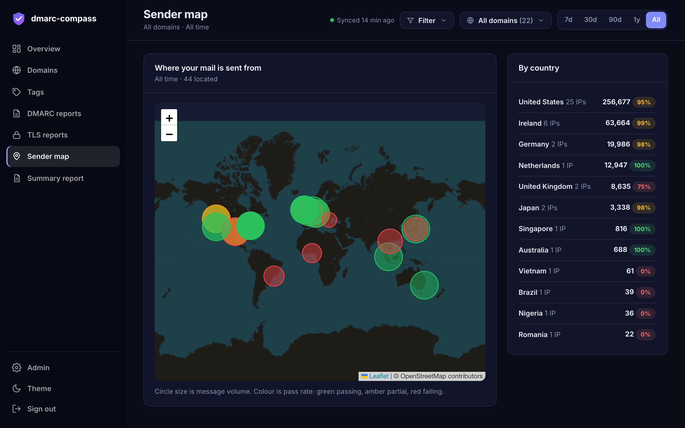
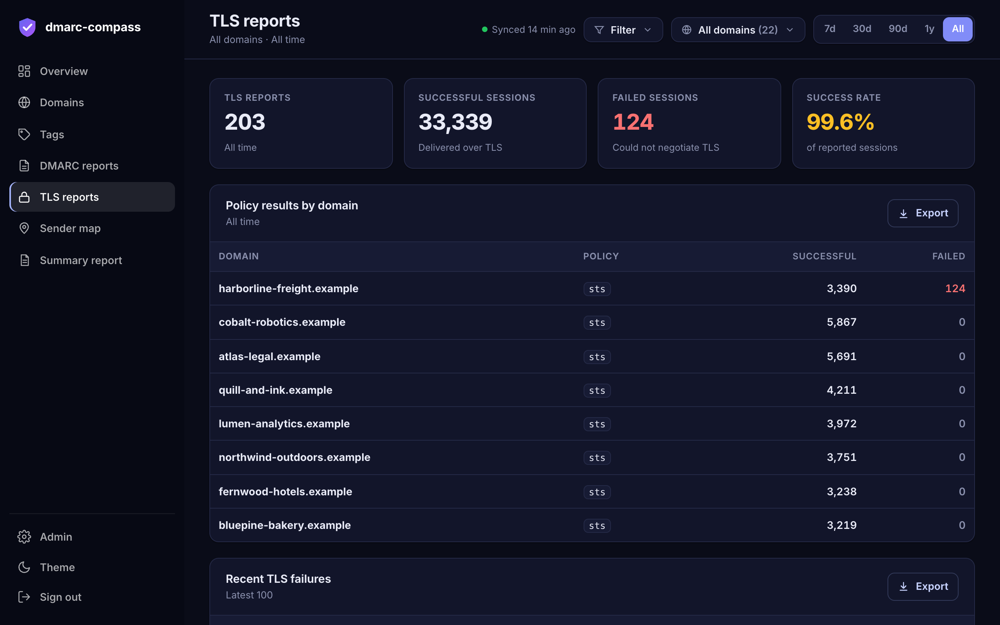
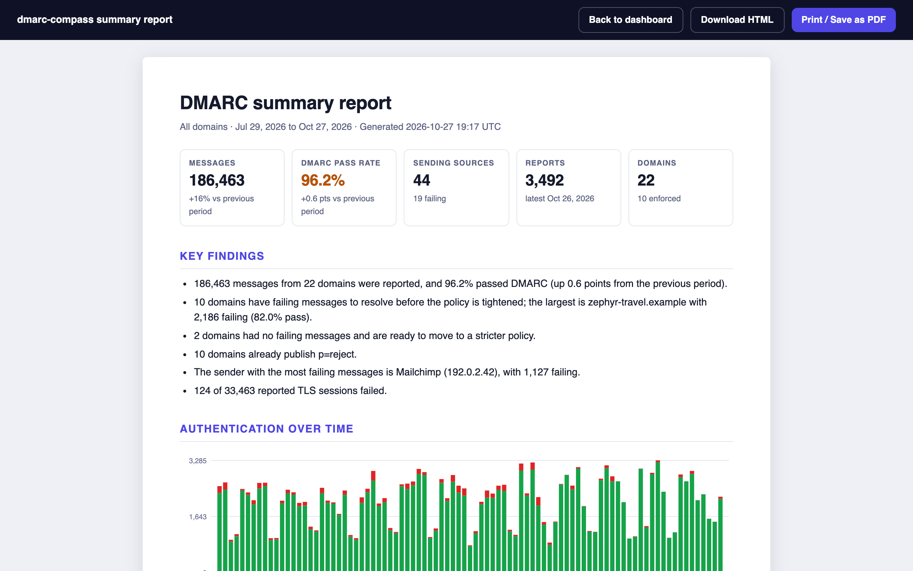
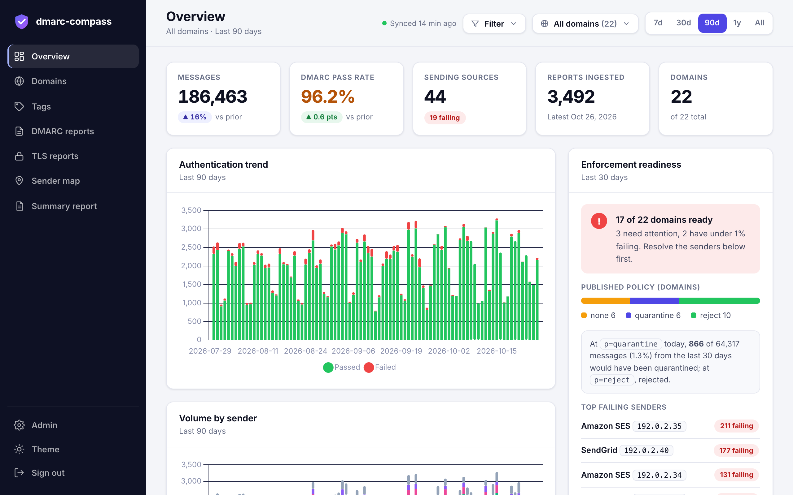

<div align="center">


# dmarc-compass

**DMARC and TLS-RPT reporting that you run yourself: on Cloudflare, in Docker, or on Kubernetes.**

Point your domains' `rua=` addresses at a mailbox and see who is sending as you,<br>what is failing, and whether you are ready to move from `p=none` to `p=reject`.


[Quick start](#quick-start) &nbsp;·&nbsp; [Features](#features) &nbsp;·&nbsp; [Screenshots](#screenshots) &nbsp;·&nbsp; [Documentation](#documentation) &nbsp;·&nbsp; [Compared with](#compared-with-other-options) &nbsp;·&nbsp; [Security](docs/security.md)

<br>



<sub>Every screenshot and recording here uses synthetic data: invented <code>.example</code> domains and documentation-range IP addresses.</sub>

</div>

<br>

## Why dmarc-compass

DMARC aggregate reports are XML files that mail providers send you every day. They are the only way to see which servers send mail as your domain, and they are unreadable in a mailbox. dmarc-compass reads them from an IMAP mailbox, keeps the history in a database you own, and turns them into answers:

- **Who is sending as my domain, and is it legitimate?** Raw IP addresses become "Amazon SES" or "Google Workspace", on a map and over time.
- **Can I enforce yet?** For each domain: which sources still fail alignment, and how many messages a stricter policy would have quarantined or rejected.
- **Did something change?** Alerts for new failing senders, pass-rate drops, policy changes and sync problems, delivered to Slack or to any URL.

It is for people who run their own domains, from one to thousands, and want the reports and the data to stay on infrastructure they control.

## Features

<table>
  <tr>
    <td width="33%" valign="top"><b>Built for many domains</b><br><sub>A searchable domain multi-select and a time range on every page, kept in the URL. Designed for fleets of hundreds or thousands of domains.</sub></td>
    <td width="33%" valign="top"><b>Tags and filters</b><br><sub>Label domains (<code>emea</code>, <code>prod</code>, <code>acquired-2024</code>), tag them automatically by name, and filter every page with AND, OR and NOT.</sub></td>
    <td width="33%" valign="top"><b>Enforcement readiness</b><br><sub>Which sources fail alignment in the last 30 days, and how many messages a tighter policy would have quarantined or rejected.</sub></td>
  </tr>
  <tr>
    <td valign="top"><b>Sender identification</b><br><sub>Raw IPs become named senders, with trends over time, every source on a map, and TLS-RPT reports alongside.</sub></td>
    <td valign="top"><b>Alerts that reach the right people</b><br><sub>Slack or signed JSON webhooks, plus a scheduled digest. Give each webhook a filter, so the EMEA channel only hears about EMEA domains.</sub></td>
    <td valign="top"><b>Exports and reports</b><br><sub>CSV or JSON from every table, matching your filters, and a printable one-document summary report you can save as PDF.</sub></td>
  </tr>
</table>

<div align="center">
  <br>
  
</div>

## Quick start

You need a **mailbox with IMAP** that receives your `rua=` reports (set-up notes are in [Your mailbox](docs/your-mailbox.md)), and one of the three places to run it. Not sure? Pick **Cloudflare** if you do not want to run anything, or **Docker** for the quickest look on your own computer. To see the interface first with no mailbox at all, use the [demo data](docs/demo.md).

| | [Cloudflare](#cloudflare) | [Docker, Compose or a VM](#docker) | [Kubernetes](#kubernetes) |
|---|---|---|---|
| **Best for** | Nothing to look after | A machine you already have | An existing cluster |
| **You need** | A Cloudflare account on the Workers Paid plan; Docker and Node.js 20+ on your computer to deploy | Docker | A cluster with block storage, and `kubectl` |
| **Cost** | About $6 to $7 a month | Your machine | Your cluster |
| **Data is kept in** | D1, managed by Cloudflare | A SQLite file in a Docker volume | A SQLite file on a persistent volume |
| **Backups** | Cloudflare keeps 30 days of point-in-time restore | You back up the file (one command) | You back up the file (one command) |
| **HTTPS** | Provided | Your reverse proxy (a Caddy example is included) | Your ingress |
| **Upgrade** | `git pull && npm install && npm run deploy` | `git pull && docker compose up -d --build` | Push a new image tag, `kubectl apply -k` |

It is the same app everywhere: the dashboards, alerts, digest, exports, sign-in and settings are identical.

### Cloudflare

```bash
git clone https://github.com/<you>/dmarc-compass.git
cd dmarc-compass
npm install
npm run setup
```

`npm run setup` logs you into Cloudflare if needed, deploys the Worker (Wrangler creates the D1 database for you), sets the admin login, and generates the encryption key. Then open `https://<your-worker>.workers.dev/admin`, sign in, add your mailbox and click **Run sync now**. Details, cost and day-to-day commands: **[Cloudflare guide](docs/cloudflare.md)**.

### Docker

```bash
git clone https://github.com/<you>/dmarc-compass.git
cd dmarc-compass
cp .env.example .env        # then edit it: ADMIN_PASSWORD and CONFIG_ENCRYPTION_KEY
docker compose up -d --build
```

Open <http://localhost:8080>, sign in, add your mailbox under **Admin → Mailboxes** and click **Run sync now**. There is no default password; Compose stops and says which value is missing. Every setting, HTTPS with Caddy, backups and upgrading: **[Docker guide](docs/self-hosting.md)**.

### Kubernetes

```bash
docker build -f deploy/docker/Dockerfile -t registry.example.com/dmarc-compass:1.0 . && docker push registry.example.com/dmarc-compass:1.0
# set newName and newTag under "images:" in deploy/kubernetes/kustomization.yaml, then:
kubectl apply -f deploy/kubernetes/namespace.yaml
kubectl -n dmarc-compass create secret generic dmarc-compass-secrets \
  --from-literal=ADMIN_USER=admin --from-literal=ADMIN_PASSWORD='choose-a-long-password' \
  --from-literal=CONFIG_ENCRYPTION_KEY="$(openssl rand -base64 32)"
kubectl apply -k deploy/kubernetes
kubectl -n dmarc-compass port-forward service/dmarc-compass 8080:80      # then open http://localhost:8080
```

The pod runs as a single replica, as a non-root user with a read-only filesystem, and meets the "restricted" Pod Security profile. Steps in detail, an Ingress example, backups and troubleshooting: **[Kubernetes guide](deploy/kubernetes/README.md)**.

### After it is running

1. Open **Admin → Mailboxes**, add the IMAP mailbox, press **Test**, then **Run sync now**. The first sync takes a few seconds (about a minute on Cloudflare while the container starts).
2. Point your domains at the mailbox with a DMARC record such as `v=DMARC1; p=none; rua=mailto:dmarc@reports.example.net`. Providers send reports about once a day, so the first data arrives within a day or two. See [Your mailbox](docs/your-mailbox.md) for the cross-domain record and provider notes.
3. Optionally tag your domains, and add a Slack or JSON webhook for alerts and a digest.

## Screenshots

<table>
  <tr>
    <td width="50%"><a href="docs/images/domains.png"></a><br><sub><b>Domains.</b> Riskiest first, with tags, policy, status, failing volume and pass rate.</sub></td>
    <td width="50%"><a href="docs/images/tags.png"></a><br><sub><b>Tags.</b> Tag many domains at once, import and export, and tag automatically by name.</sub></td>
  </tr>
  <tr>
    <td><a href="docs/images/filter-builder.png"></a><br><sub><b>Filters.</b> Tags, domain names and policy, with AND, OR and NOT, on every page.</sub></td>
    <td><a href="docs/images/admin-webhooks.png"></a><br><sub><b>Webhooks.</b> Slack or signed JSON, each sent only the domains it should get.</sub></td>
  </tr>
  <tr>
    <td><a href="docs/images/map.png"></a><br><sub><b>Sender map.</b> Sized by volume, coloured by pass rate.</sub></td>
    <td><a href="docs/images/tls.png"></a><br><sub><b>TLS reports.</b> Session success per domain and the latest failures.</sub></td>
  </tr>
  <tr>
    <td><a href="docs/images/summary-report.png"></a><br><sub><b>Summary report.</b> A one-document summary to print to PDF or download as HTML.</sub></td>
    <td><a href="docs/images/overview-light.png"></a><br><sub><b>Light theme.</b> Dark is the default; switch from the sidebar.</sub></td>
  </tr>
</table>

## Documentation

| | |
|---|---|
| **Install** | [Cloudflare](docs/cloudflare.md) · [Docker, Compose or a VM](docs/self-hosting.md) · [Kubernetes](deploy/kubernetes/README.md) |
| **Set up** | [Your mailbox](docs/your-mailbox.md) (DNS records, Gmail, Fastmail, Zoho, Microsoft 365) · [Try the demo data](docs/demo.md) |
| **Use it** | [Using the dashboard](docs/using-the-dashboard.md) (pages, sync schedule, several mailboxes, exports) · [Tags and filters](docs/tags-and-filters.md) · [Notifications](docs/notifications.md) (Slack, signed JSON webhooks, per-webhook filters) |
| **Run it** | [Operating it](docs/operating.md) (logs, updates, backups, uninstall) · [Scale](docs/scale.md) (measured timings) |
| **Understand it** | [How it works](docs/how-it-works.md) · [Security model](docs/security.md) · [Limitations](docs/limitations.md) |
| **Contribute** | [Contributing](CONTRIBUTING.md) · [Reporting a vulnerability](SECURITY.md) |

## Compared with other options

**The upstream parser, [dmarc-report-viewer](https://github.com/cry-inc/dmarc-report-viewer).** dmarc-compass runs it unmodified as the parser. On its own, the upstream program is a single standalone viewer: it keeps everything in memory, re-reading it from the one IMAP account it is configured with, stores nothing in a database, and puts Basic Auth in front. dmarc-compass adds what a long-lived deployment needs on top of it: a database that keeps the history after mail is deleted or the process restarts, several mailboxes, a sign-in page, tags and filters, alerts and a digest, exports, and the three ways of running it. If you only want a quick look at one mailbox, the upstream program alone is simpler.

**Hosted DMARC services.** A hosted service receives your reports for you, can host the DNS record changes, and comes with support. That is the right choice if you want it managed for you. dmarc-compass is for the case where you want the reports and the history on your own account or servers, at the price of a mailbox and a small deployment, and without a support contract.

**Things it does not do:** forensic (RUF) reports, email delivery of alerts, or running as more than one instance. The full list is in [Limitations](docs/limitations.md).

## Status and limitations

**Status: early.** It does what is described here and nothing more. The checks that run on every change: the unit tests, and an end-to-end test of the Docker image and of the Kubernetes manifests with the real parser and a real IMAP server. The Cloudflare path is tested by unit tests and by a live deployment.

The main limits, in short:

- One instance on every platform. Fine for hundreds of domains' worth of reports; not horizontally scaled.
- Long time ranges (a year or all time) over very large fleets are slow. [Scale](docs/scale.md) lists the measured figures.
- No forensic (RUF) reports, and alerts do not cover TLS failures yet or arrive by email.
- Microsoft 365 mailboxes need a proxy, because password-based IMAP is no longer offered.
- Geolocation uses ip-api.com, whose free tier is for non-commercial use only.

[All limitations](docs/limitations.md).

## Roadmap

Email delivery and TLS failure alerts · enforcement rollout tracking over time (`pct=25 → 100 → reject`) · a published container image · BIMI readiness check · JSON API.

## Contributing and security

Issues and pull requests are welcome; see [CONTRIBUTING.md](CONTRIBUTING.md). Found a vulnerability? Please report it privately, as described in [SECURITY.md](SECURITY.md), rather than in a public issue.

## License

[MIT](LICENSE). Built on [dmarc-report-viewer](https://github.com/cry-inc/dmarc-report-viewer) by cry-inc (MIT), run unmodified. See [NOTICE.md](NOTICE.md) for third-party software and service terms.
