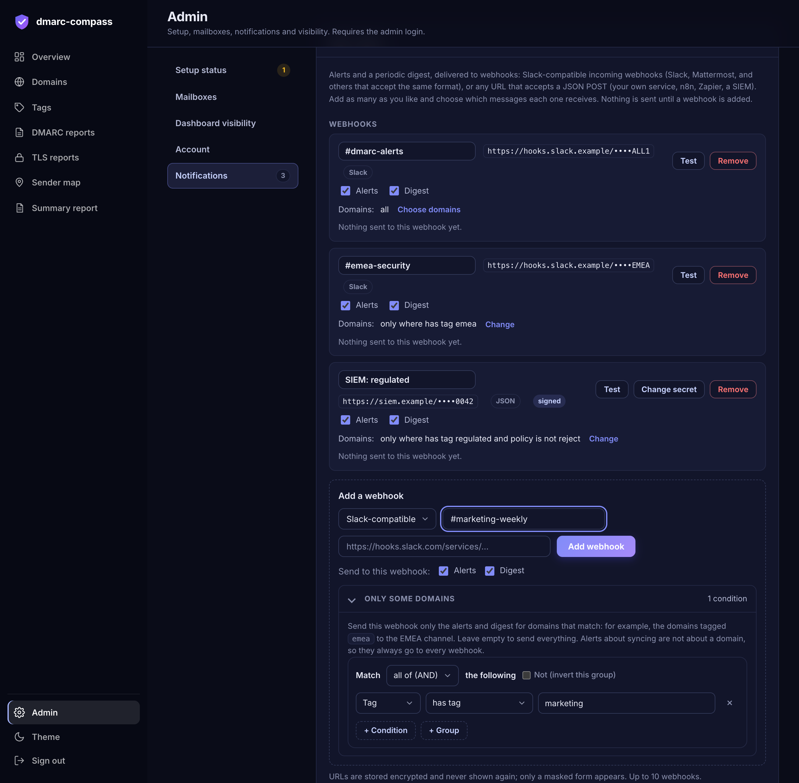

# Notifications

[← Back to the README](../README.md)

Alerts and a periodic digest go to one or more **webhooks**: Slack-compatible incoming webhooks (Slack, Mattermost, and others that accept the same format), or **JSON webhooks** that POST a structured document to any URL (your own service, n8n, Zapier, a SIEM). Nothing is sent until you add one.

1. In Slack, create an *Incoming Webhook* for the channel you want and copy its URL.
2. Open **Admin → Notifications**, give it an optional **nickname** (for example `#dmarc-alerts`), paste the URL, and press **Add webhook**.
3. Press **Test** on its row to confirm a message arrives.

Choose the **type** when you add a webhook. Each webhook is a row showing its nickname, its type, a masked form of its URL, whether it receives **Alerts** and/or the **Digest** (so security alerts and a management digest can go to different channels), and how its last delivery went. Rename it, change what it receives, **Test** it or **Remove** it right from the row. You can add up to 10. A webhook supplied as a `SLACK_WEBHOOK_URL` Worker secret appears as a read-only row.

**Alert rules.** Checked after every sync. Each event is reported once, and several alerts from one sync arrive as one message.

| Rule | Fires when | Default |
|---|---|---|
| **New failing sender** | A source fails DMARC for a domain it was not seen on before | at least 20 failing messages |
| **Pass rate dropped** | A domain's pass rate over the last 7 days is lower than the 7 days before | 5 points, at least 100 messages in each week |
| **Policy changed** | A domain's published `p=` or `pct=` changed (stricter or relaxed) | on |
| **Sync problem** | Syncing is failing or has stopped; a note is sent when it recovers | 90 minutes without a successful sync, or three times the sync interval if that is longer |

**Digest.** Off by default. Choose every day, every week, every month, or every *N* days, plus the time and time zone. It covers the last complete days of that period: messages and pass rate against the period before, domain status, the most failing domains, policy changes and new failing senders. Digests are sent within 5 minutes of the chosen time; if a run is missed it is sent once on the next run.

**Preview alerts** shows what the rules would have reported over the last 7 days without sending anything, and **Send digest now** sends one immediately.

<a href="images/admin-webhooks.png"></a>

**Send each webhook only some domains.** Open **Only some domains** when you add a webhook, or press **Choose domains** (or **Change**) on its row, and build a filter with the same builder as the filter bar: conditions on a **tag**, the **domain name** or its **policy**, joined by all-of (AND) or any-of (OR), with *Not*, in groups. For example, `has tag emea` for the EMEA channel, or `has tag prod and policy is not reject` for the domains still to be tightened. A webhook with a filter receives only the alerts for the domains that match, and its digest is built from those domains alone (totals, pass rate, status counts, most failing domains, policy changes, new failing senders), with a line at the top saying so. *Send everything* removes the filter.

- Webhooks with the same filter are handled together, and one with no filter gets everything, so you can have an all-domains webhook beside the scoped ones.
- The filter is read each time, so a domain that gets the tag later starts to count at once. Alerts from before that are not sent again.
- Alerts about syncing are not about a domain, so they go to every webhook whatever its filter.
- A webhook whose filter matches no domain is skipped for the digest, and its row says "nothing sent: no domain matches this webhook's filter".
- An alert that no webhook's filter covers is dropped, not saved up for later.
- Tags are for routing here, not for access: a webhook URL is still just a URL, and the dashboard's sign-in is what protects the data.
- JSON webhooks get a `scope` field (`{ "filter": "has tag emea" }`, plus `domains` on a digest) or `null` when unfiltered.

If every webhook that should receive an alert is unreachable, nothing is lost: an alert is only marked as sent once at least one webhook accepts it, so it is retried on the next run. If one of several is down, the others still deliver, and the failure is shown on that row. A notification problem never fails a sync.

## JSON webhooks

A JSON webhook receives `POST` requests with `Content-Type: application/json`. Every document has `schema` (for example `dmarc-compass.alerts.v1`; the suffix changes only on a breaking change), `event` (`alerts`, `digest` or `test`), `source` and `sent_at` (ISO 8601, UTC), and `links` back to the dashboard once you have opened Admin.

```json
{
  "schema": "dmarc-compass.alerts.v1",
  "event": "alerts",
  "count": 2,
  "alerts": [
    { "rule": "new_failing_sender", "message": "example.com Amazon SES 192.0.2.1 75 failing of 75 messages",
      "domain": "example.com", "source_ip": "192.0.2.1", "sender": "Amazon SES", "failing_messages": 75, "total_messages": 75 },
    { "rule": "pass_rate_drop", "domain": "example.com", "previous_pass_rate_pct": 99.1, "current_pass_rate_pct": 84.3, "drop_points": 14.8 }
  ]
}
```

Alert rules are `new_failing_sender`, `pass_rate_drop`, `policy_change` and `sync_problem`. The digest document has `period`, `totals` (messages, pass rate, previous pass rate, sources), `domains` (counts by status and the most failing), `policy_changes` and `new_failing_senders`.

**Signing.** If you set a signing secret, each request carries `X-Dmarc-Compass-Timestamp` and `X-Dmarc-Compass-Signature: sha256=<hex>`, where the signature is `HMAC-SHA256(secret, "<timestamp>.<raw body>")`. Verify it, and reject old timestamps so a captured request cannot be replayed:

```js
import { createHmac, timingSafeEqual } from "node:crypto";

function verify(rawBody, headers, secret, toleranceSeconds = 300) {
  const ts = headers["x-dmarc-compass-timestamp"];
  if (Math.abs(Date.now() / 1000 - Number(ts)) > toleranceSeconds) return false;
  const expected = "sha256=" + createHmac("sha256", secret).update(`${ts}.${rawBody}`).digest("hex");
  const given = headers["x-dmarc-compass-signature"] ?? "";
  return given.length === expected.length && timingSafeEqual(Buffer.from(given), Buffer.from(expected));
}
```

Respond with any `2xx` status. A non-`2xx` response or a timeout (8 seconds) is treated as a failed delivery.
